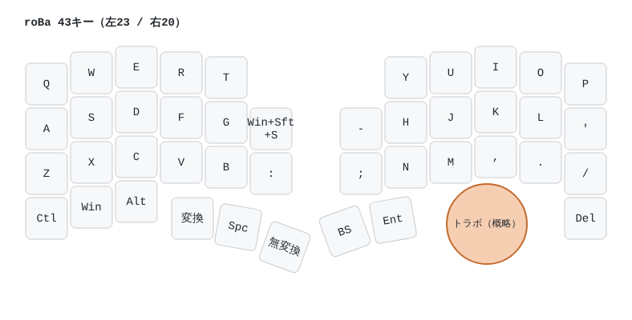
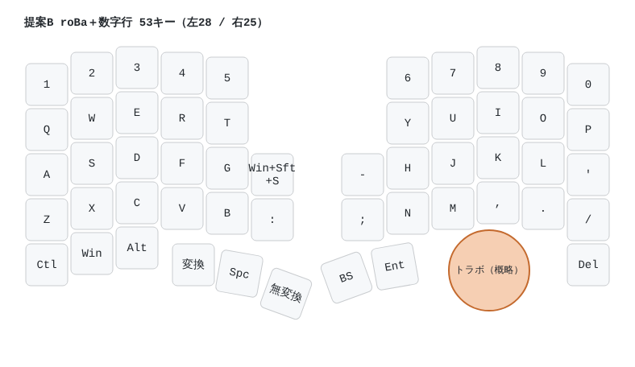
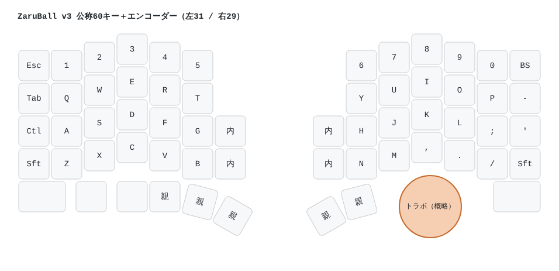
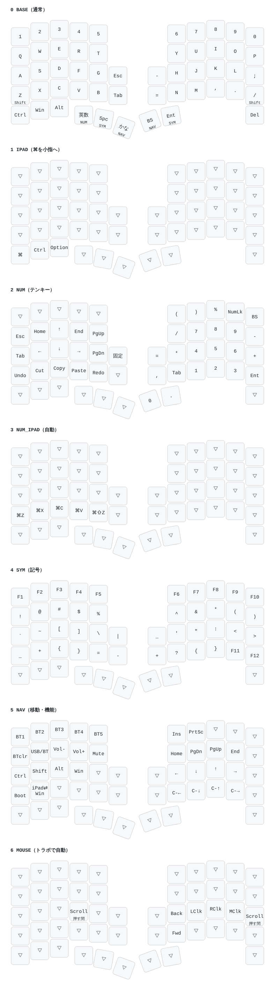

# 配列案（roBa / ZaruBall を参考）

`python3 build_layouts.py` で `.json`（Auto-KDK や QMK info.json 形式の座標）、`.yaml`、`.svg` を出力する。
トラックボールの円は写真からの概略位置。

| 案 | キー数 | 特徴 |
|---|---|---|
| roBa | 43（左23 / 右20） | 5列＋内側1列、数字行なし。コンパクトで、数字や記号はレイヤーで打つ |
| **提案B**（roBa＋数字行）**← 採用** | 53（左28 / 右25） | roBa の形に数字行を足した案。資料の目安「片手25〜30キー」に収まる |
| ZaruBall v3 | 公称60＋エンコーダー（左31 / 右29） | 外側の列（Esc/Tab/Ctl/Sft）と数字行あり。keyball61 に近いフルセット |

## ピン数の目安（無線版はトラボ側が「行＋列」14本まで）
- roBa 形の右手: 4行×6列 → 10本
- 提案B の右手: 5行×6列 → 11本
- ZaruBall 形の右手: 5行×7列 → 12本

※ Auto-KDK 上でどう行列を割り当てるかは、実際に配置して Matrix Editor の表示で確認する。

## レイヤー案（提案B）
`python3 keymap_proposal_b.py` で `keymap-proposal-b.svg` を出力する。

| レイヤー | 入り方 | 内容 |
|---|---|---|
| 0 BASE | 通常（Windows 用） | QWERTY。Z と / は長押しで Shift。記号は JIS 配列用キーコード（`../firmware/jp_keys.h`） |
| 1 IPAD | NAV の「iPad⇄Win」で切替 | ⌘ を小指（Ctrl の位置）、Ctrl をその右に。ほかは BASE と同じ |
| 2 NUM（テンキー） | 「英数」を長押し。左内側の「固定」で固定/解除 | 右手にテンキー（789/456/123/0.）、左手に矢印と Undo/Copy/Paste |
| 3 NUM_IPAD | NUM と IPAD が両方オンのとき自動 | Undo/Copy/Paste を ⌘ 版に |
| 4 SYM（記号） | Spc か Ent を長押し | 記号と F1〜F12 |
| 5 NAV（移動・機能） | 「かな」か BS を長押し | HJKL の矢印、Bluetooth 切替（BT1〜5）、OS 切替、音量、書き込みモード |
| 6 MOUSE | トラボを動かすと自動 | クリック、戻る/進む。Scroll を押す間はボールでスクロール |

英数キーは LANG2＋無変換、かなキーは LANG1＋変換 を続けて送る（Windows と iPad の両方で効かせるため。iPad は要確認）。

